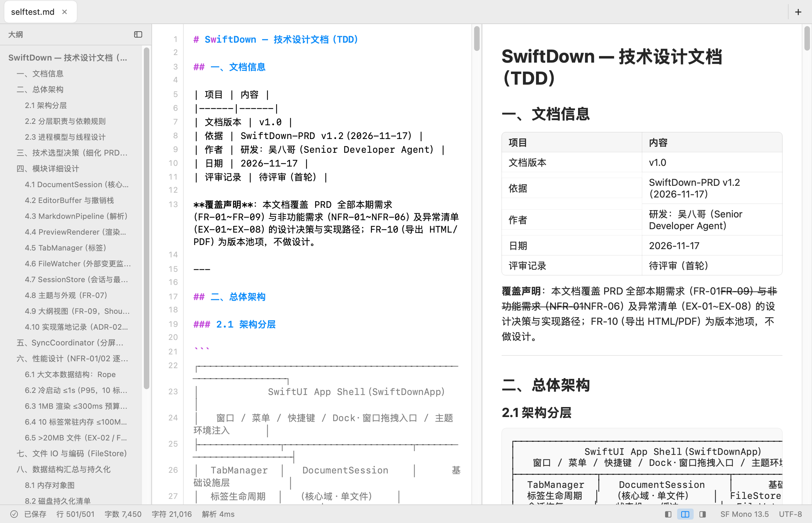
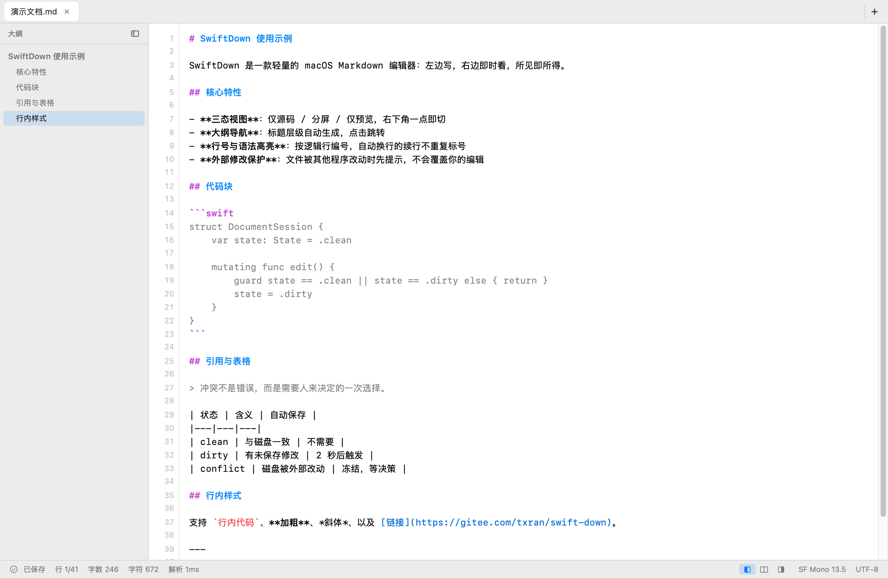
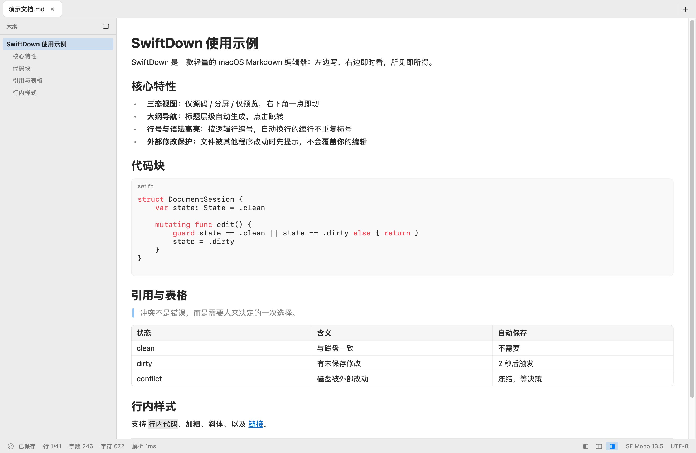
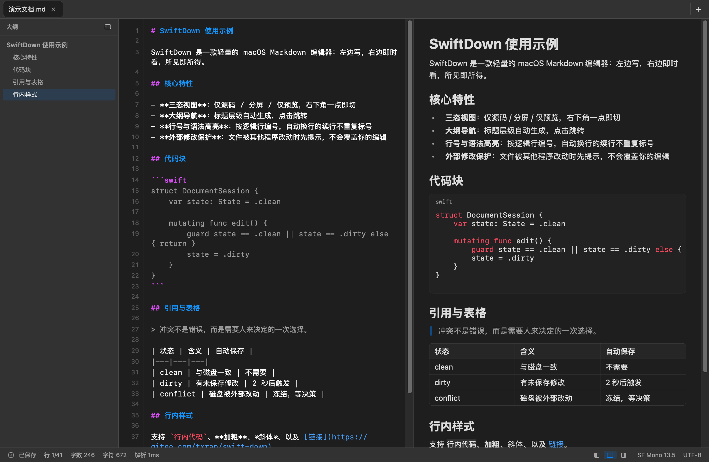
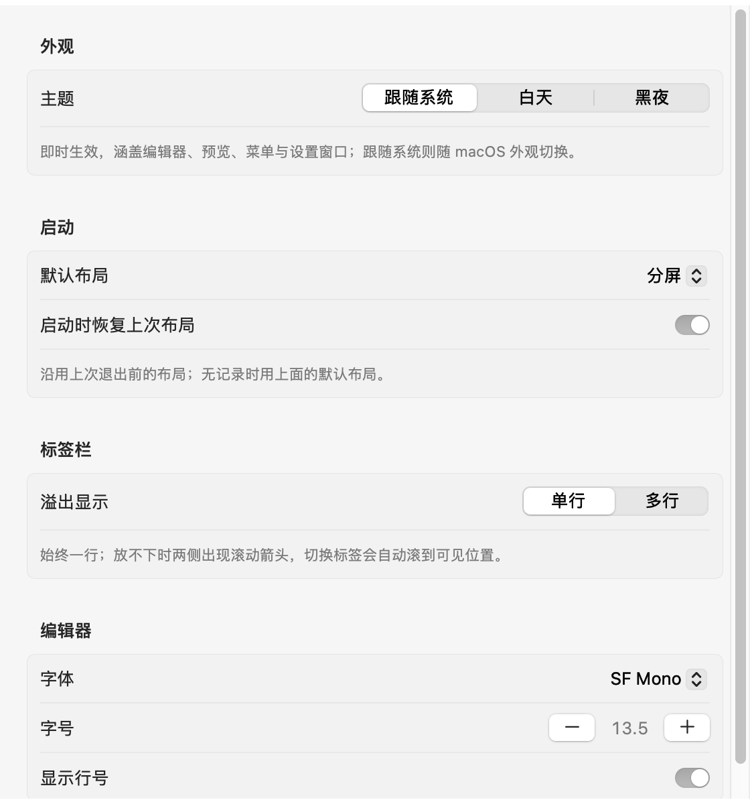
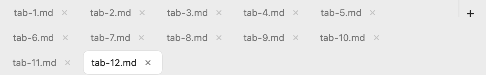

# SwiftDown

一款轻量的 macOS Markdown 编辑器：左边写，右边即时看。

原生 Swift + SwiftUI + AppKit，无第三方 UI 框架；启动快、占用小，专注「打开就能写」。

> 主仓库在 [Gitee](https://gitee.com/txran/swift-down)，[GitHub](https://github.com/txran/SwiftDown) 为镜像，两边内容同步。



## 特性

| 能力 | 说明 |
|---|---|
| **三种视图** | 仅源码 / 分屏 / 仅预览，右下角一点即切，也可用 ⌘1、⌘⇧1、⌘2 |
| **即时预览** | 输入停顿 200ms 后解析，标题、列表、表格、代码块、引用、行内样式全部支持 |
| **大纲导航** | 按标题层级自动生成，点击跳转；随编辑实时刷新 |
| **行号与高亮** | 按逻辑行编号，自动换行的续行不重复标号；标题/代码/引用/强调分色 |
| **多标签** | 拖拽排序、右键菜单（复制路径 / 访达显示 / 关闭其他）；标签多了可切「单行滚动」或「多行换行」 |
| **自动保存** | 停止输入 2 秒落盘；失焦与退出前强制落盘 |
| **外部修改保护** | 文件被其他程序改动时进入冲突态：编辑冻结、横幅提示，由你选择采用磁盘版 / 保留我的 / 另存副本 |
| **主题** | 跟随系统 / 白天 / 黑夜，覆盖编辑器、预览、菜单与设置窗口 |
| **可配快捷键** | 设置内录制，自动检测冲突，可一键恢复默认 |
| **大文件保护** | 超过 20MB 自动进入只读源码模式，避免卡顿 |
| **会话恢复** | 重开应用回到上次的标签与布局（可关） |

## 界面

| 仅源码 | 仅预览 |
|---|---|
|  |  |



<p align="center">
  
  
</p>

## 下载安装

不想自己编译就直接下发行版：[**Releases**](https://gitee.com/txran/swift-down/releases)

当前版本 **0.1.2**：[发行说明](https://gitee.com/txran/swift-down/releases/tag/v0.1.2)

| 文件 | 用法 |
|---|---|
| [`SwiftDown-0.1.2-arm64.dmg`](https://gitee.com/txran/swift-down/releases/download/v0.1.2/SwiftDown-0.1.2-arm64.dmg) | 打开后把 SwiftDown 拖进「应用程序」 |
| [`SwiftDown-0.1.2-arm64.zip`](https://gitee.com/txran/swift-down/releases/download/v0.1.2/SwiftDown-0.1.2-arm64.zip) | 解压即用，适合脚本化下载 |

```bash
# 命令行安装（不想拖拽时）
curl -L -o /tmp/SwiftDown.zip \
  https://gitee.com/txran/swift-down/releases/download/v0.1.2/SwiftDown-0.1.2-arm64.zip
ditto -x -k /tmp/SwiftDown.zip /Applications
xattr -dr com.apple.quarantine /Applications/SwiftDown.app
```

- **仅 Apple Silicon（arm64）**，macOS 13+；Intel 机器请按下面的方式自行编译。
- 发行包是 ad-hoc 签名（无开发者证书）。首次打开被拦时：访达里右键 → 打开；
  或执行 `xattr -dr com.apple.quarantine /Applications/SwiftDown.app`。

## 系统要求

- macOS 13 Ventura 及以上
- Swift 5.9+
- **只需 Command Line Tools，不需要完整 Xcode**（`xcode-select --install` 即可）

## 构建与运行

```bash
git clone git@gitee.com:txran/swift-down.git
cd swift-down

# 发布构建（产物：build/SwiftDown.app）
./Scripts/build-app.sh release

# 运行
open build/SwiftDown.app
```

调试构建：`./Scripts/build-app.sh debug`

> **开发构建叫「SwiftDown Dev」**，bundle id 是 `dev.swiftdown.app.dev`，与从发行包装到
> 「应用程序」里的 `SwiftDown`（`dev.swiftdown.app`）是两个独立应用。真实产物放在
> `build/.dev/`，`build/SwiftDown.app` 只是指向它的符号链接。
> 这样做是为了避免两个同名同图标、同 bundle id 的副本同时被系统登记（会导致「应用程序」里
> 出现两个图标、⌘Tab 里出现两个同款图标、以及「打开方式」指向不确定的那一份）。

要发给别人用的发行包（产出 `.dmg` 与 `.zip` 到 `build/dist/`）：

```bash
./Scripts/package-app.sh
```

打开单个文件也可以直接：

```bash
open -a "$PWD/build/SwiftDown.app" 你的文档.md
```

> 首次打开若提示「无法验证开发者」：在访达里右键 → 打开；或执行
> `xattr -dr com.apple.quarantine build/SwiftDown.app`。
> 构建脚本用的是 ad-hoc 签名，与 Xcode 正式签名的差异仅此而已。

## 命令行参数

| 参数 | 作用 |
|---|---|
| `--selftest <文件>` | 无头端到端自检：真实视图树 + 真实文件 IO，跑完打印 `SELFTEST RESULT` |
| `--selftest <文件> --snapshot` | 同上，并把界面离屏渲染成 PNG（`/tmp/swiftdown-*.png`） |
| `--render <文件> --out <png>` | 只出图：`[--size 1320x860] [--mode editor\|split\|preview] [--theme light\|dark\|system] [--outline 0\|1]` |
| `--render ... --settings general` | 渲染设置页（`general` / `shortcuts`） |

```bash
./build/SwiftDown.app/Contents/MacOS/SwiftDown --selftest SwiftDown-Design.md
# === 自检结束：通过 全部，失败 0 项 ===
# SELFTEST RESULT: ALL PASS

# 文档截图就是这条命令出的（用独立设置域，不碰你的偏好）
./build/SwiftDown.app/Contents/MacOS/SwiftDown \
  --render 你的文档.md --out /tmp/shot.png --mode split --theme dark
```

## 项目结构

四个 SPM 包，依赖方向自上而下，前三层不依赖 AppKit，可独立测试：

```
Packages/
├── SwiftDownCore/        文档状态机：clean / dirty / conflict / missing / placeholder
│                         唯一写盘入口，冲突期写入冻结（23 个单测）
├── SwiftDownPipeline/    Markdown 解析：swift-markdown → 与渲染无关的抽象 AST（18 个单测）
├── SwiftDownEditorKit/   编辑器内核：分块行索引、差量撤销、语法辅助（25 个单测）
└── SwiftDownApp/         SwiftUI 壳 + AppKit 编辑渲染 + 自检与出图（72 项端到端断言）
```

设计取舍见 [SwiftDown-Design.md](SwiftDown-Design.md) 的 ADR 列表（文本引擎、行索引、冲突写入冻结、模态呈现约束等）。

## 开发

跑单元测试（本机只有 CLT 时需要显式给出 swift-testing 插件路径）：

```bash
swift test --disable-sandbox \
  --package-path Packages/SwiftDownCore \
  -Xswiftc -plugin-path \
  -Xswiftc /Library/Developer/CommandLineTools/usr/lib/swift/host/plugins/testing
```

`--disable-sandbox` 是必需的：SPM 的插件沙箱在没有完整 Xcode 的环境下会拒绝加载 swift-testing 宏插件。

端到端自检（每次改动后跑一遍，输出 72 项 PASS/FAIL）：

```bash
./Scripts/build-app.sh release
./build/SwiftDown.app/Contents/MacOS/SwiftDown --selftest SwiftDown-Design.md
```

## 已知限制

- 预览 → 编辑区反向滚动尚未实现（目前是编辑区滚动带动预览按标题对齐）
- 大文档（>20MB）只读，未做增量索引
- 代码高亮是词法级，不是语法树级
- 未做 App Sandbox / 安全书签（当前按非沙箱分发）

## 文档

- [SwiftDown-PRD.md](SwiftDown-PRD.md) — 需求文档
- [SwiftDown-Design.md](SwiftDown-Design.md) — 架构设计与 ADR
- [Docs/M1-app-shell.md](Docs/M1-app-shell.md) — M1 落地记录与自检基线

## License

[Apache License 2.0](LICENSE)
